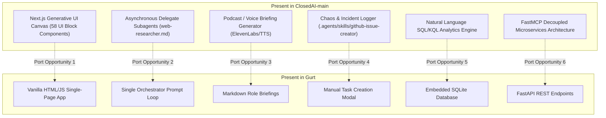

# Gurt Event Operations Platform — Capabilities, Implementation Audit & Gap Analysis

**Document Version:** 1.0  
**Date:** October 18, 2026  
**Audience:** DubHacks Organizing Team, Engineering Leads, and Evaluators  
**System Under Review:** `gurt/` (Event Operations Agent) & Reference Codebase `ClosedAI/`  

---

## Executive Summary

**Gurt** is an autonomous event operations agent engineered to assist small organizing teams with the high-stakes operational chaos of planning and executing technical conferences and workshops. It provides a multi-event workspace with an interactive chat terminal, an expandable operational Side Canvas, human-in-the-loop (HITL) safety gates, vendor and speaker sourcing pipelines, AcroForm PDF contract compilation, precision minute math conflict detection, and role-specific data-leak-free briefings.

This document provides a transparent and rigorous technical audit of:
1. **Every capability that exists in Gurt right now**, down to the exact data schemas, mathematical engines, and APIs.
2. **What is genuinely working in production vs. what is simulated, mocked, or heuristic-based.**
3. **An architectural comparison with `ClosedAI`**, identifying valuable capabilities, skills, and UI components from the parent repository that could be ported into Gurt.

---

## 1. Current Capabilities Matrix

| Area | Feature / Capability | Operational State | Implementation Basis |
| :--- | :--- | :--- | :--- |
| **Outreach** | Speaker Candidate Discovery & Sourcing | ✅ Fully Working | Tavily Web Search API + Labeled Fallback Fixtures |
| **Outreach** | Cold Outreach Drafting & Deduplication | ✅ Fully Working | SQLite Action Proposals + Exact Recipient/Type Deduplication |
| **Outreach** | Inbound Reply Signal Extraction | ⚠️ Heuristic / Manual | Regex & Keyword Signal Parsing (Pasted text input) |
| **Outreach** | Outbound Message Dispatch | ⚠️ Semi-Simulated | Resend REST API (when key active); Local SQLite Outbox (fallback) |
| **Outreach** | Slack / Teams Communication | ⚠️ Simulated / Mocked | Recorded Delivery state in SQLite (no active Webhook/Graph API) |
| **Vendors** | Sourcing & Quote Comparison | ✅ Fully Working | Price-per-head math, dietary capability, budget ceiling alerts |
| **Vendors** | Requirements & Unknowns Tracker | ✅ Fully Working | Structured SQLite schema with pax, budget, and open unknowns |
| **Vendors** | Supplier Compliance & Insurance Check | ✅ Fully Working | Compliance verification flags, permit notes, liability tracking |
| **HITL** | Action Center & Approval Gate | ✅ Fully Working | Consequential action blocking, draft editing, double-exec guard |
| **Documents** | Supported AcroForm PDF Form Filling | ✅ Fully Working | ReportLab template generation + `pypdf` AcroForm field mapping |
| **Documents** | Decoupled Signing & Submission Guard | ✅ Fully Working | Draft watermark, explicit missing-field audit, signing prevention |
| **Logistics** | Precision Minute Math & Run-of-Show | ✅ Fully Working | Integer minute math `[start, end)`, chronological timeline sort |
| **Logistics** | Critical Path DAG Analysis | ✅ Fully Working | Kahn's Topological Sort Algorithm across task dependencies |
| **Logistics** | Exclusive Room Collision Detection | ✅ Fully Working | Half-open interval intersection with shared space filtering |
| **Logistics** | Turnover Buffer Gap Analysis | ✅ Fully Working | 10-15m setup/teardown window verification between sessions |
| **Logistics** | What-If Schedule Impact Simulation | ✅ Fully Working | Non-mutating schedule simulation testing downstream conflicts |
| **Logistics** | Role-Specific Briefing Engine | ✅ Fully Working | Positive Projection allowlists + strict anti-leak assertions |
| **Logistics** | State Fingerprinting & Audit Logging | ✅ Fully Working | Deterministic SHA-256 state hashing + append-only audit trail |
| **Platform** | Multi-Event Workspace Isolation | ✅ Fully Working | `event_id` foreign key isolation across 10 distinct DB tables |
| **Platform** | Two-Tier Orchestrator | ✅ Fully Working | Gemini 3.8 / 3.5 Flash Tool Calling + Local Semantic Fallback |
| **Frontend** | Interactive Side Canvas & Operations Views | ✅ Fully Working | Vanilla JS/CSS dashboard with 10 tabbed operations views |

---

## 2. Deep-Dive: Exactly How Everything Is Implemented

### 2.1 Multi-Event Isolation & Persistence Model
- **File:** [`gurt/gurt/db.py`](file:///d:/github/closedAI/gurt/gurt/db.py)
- **Database Engine:** Local SQLite database (`gurt_events.db`), with write-ahead logging (WAL) support and relational foreign-key style event boundaries.
- **Tenancy Architecture:** Every operational table (`tasks`, `speakers`, `vendors`, `vendor_requirements`, `sponsors`, `schedules`, `action_proposals`, `pdf_documents`, `conversations`, `messages`, `memories`, `briefings`, `audit_logs`) includes an `event_id` column (e.g., `evt-dubhacks-2026`, `evt-loveable-2026`).
- **Dynamic Seeding & Protection:** If an event record is modified or a new event is created via `/api/events`, the database isolates all associated quotes, schedules, and chats. A benchmark dataset for **DubHacks 2026 Agentic AI Workshop** (80 pax, $2,500 budget, Kane Hall) is automatically verified on startup.

### 2.2 Human-in-the-Loop (HITL) Action Center
- **Files:** [`gurt/gurt/tools/outreach_tools.py`](file:///d:/github/closedAI/gurt/gurt/tools/outreach_tools.py), [`gurt/gurt/api/server.py`](file:///d:/github/closedAI/gurt/gurt/api/server.py), [`gurt/gurt/static/app.js`](file:///d:/github/closedAI/gurt/gurt/static/app.js)
- **How It Works:**
  1. When Gurt or the user initiates an outreach action (e.g., *"Draft an email to Dr. Alicia Chen"*), the tool `tool_draft_outreach` does **NOT** dispatch a network call.
  2. It checks whether a draft for the same recipient and action type already exists in `action_proposals` with `status = 'pending_approval'`. If found, it updates the draft in place to prevent duplicate outreach.
  3. The proposal is saved with a unique ID (`act-XXXXXX`), full payload, and status `pending_approval`.
  4. The frontend **Action Center** highlights the pending item with full markdown preview and two action buttons: **Approve & Send**, **✎ Edit Draft**, and **Dismiss**.
  5. The organizer can edit the draft subject or message body directly in the modal via `PATCH /api/actions/{id}` prior to approval.
  6. When the organizer clicks **Approve**, `POST /api/actions/{id}/approve` triggers `execute_approved_action`. A double-execution guard immediately rejects any action not currently in `pending_approval`.

### 2.3 Standout Workflow: AcroForm PDF Contract Filling
- **File:** [`gurt/gurt/tools/pdf_tools.py`](file:///d:/github/closedAI/gurt/gurt/tools/pdf_tools.py)
- **How It Works:**
  1. **Template Generation:** If the template `UW_HUB_Event_Facility_Booking_Contract.pdf` is missing, ReportLab constructs an authentic fillable AcroForm with 16 distinct form fields (`event_name`, `event_date`, `expected_attendance`, `catering_vendor`, `catering_total_cost`, `organizer_phone`, `budget_code`, `insurance_policy_number`, `authorized_signatory_name`, etc.).
  2. **Inspection:** `pypdf.PdfReader` inspects the template and catalogues all interactive form widgets.
  3. **Positive Fact Mapping:** Gurt queries the active event brief and confirmed vendor quotes from SQLite. It maps known facts (title, date, location, headcount, catering company, price).
  4. **Explicit Unresolved Fields Audit:** Gurt identifies fields that cannot be safely populated autonomously (e.g., on-site 24-hr emergency phone, UW faculty budget code, liability insurance policy #, official officer signature). It bundles these into an `unresolved_missing_fields` list.
  5. **Draft Watermarking & Decoupled Signing:** `pypdf.PdfWriter` writes the filled fields into a new draft file (`doc-hub-booking-..._draft.pdf`). The original template is left completely untouched. The system strictly refuses to forge or attach a digital signature, stamping the document: *DRAFT ONLY - Manual organizer review required before signing*.
  6. **Download:** The filled draft is served live via `/api/pdf/download/{filename}`.

### 2.4 Precision Logistics & Conflict Detection Engine
- **Files:** [`gurt/gurt/logistics/schedule_engine.py`](file:///d:/github/closedAI/gurt/gurt/logistics/schedule_engine.py), [`gurt/gurt/logistics/conflict_engine.py`](file:///d:/github/closedAI/gurt/gurt/logistics/conflict_engine.py)
- **Mathematical Foundations:**
  - **Integer Minute Arithmetic:** All schedule strings (`"09:30"`, `"10:15"`) are normalized to integer minute timestamps from midnight (e.g., $570 \to 615$). This completely eliminates daylight/timezone parsing discrepancies and string comparison bugs.
  - **Half-Open Intervals:** Time slots are evaluated as $[S_A, E_A)$ and $[S_B, E_B)$. Two sessions collide if and only if:
    $$\max(S_A, S_B) < \min(E_A, E_B)$$
  - **Shared Space Filtering:** Shared spaces (`Lobby`, `Foyer`, `Atrium`, `Registration Desk`, `Lounge`) are explicitly excluded from exclusive room collision checks, permitting concurrent networking and check-in activities.
  - **Turnover Buffers:** For consecutive sessions in the same exclusive room, the gap must satisfy:
    $$\text{Gap} = S_B - E_A \ge \max(10, \text{Teardown}_A, \text{Setup}_B)$$
    If $0 \le \text{Gap} < \text{Buffer}$, an `insufficient_turnover_buffer` warning is triggered.
  - **Kahn's Topological Sort (Critical Path):** The DAG of logistics tasks is parsed into an in-degree adjacency list. Kahn's algorithm iterates through zero-in-degree nodes, computing the longest path distance to identify the non-parallelizable bottlenecks in the event setup.
  - **What-If Simulation:** `analyze_schedule_impact` accepts a candidate change (e.g., shifting keynote from 10:00 to 10:30), creates a deep copy of the schedule, and simulates collision and buffer metrics without mutating the persistent database.

### 2.5 Role-Specific Briefings (Positive Projection & Anti-Leakage)
- **File:** [`gurt/gurt/logistics/briefing_engine.py`](file:///d:/github/closedAI/gurt/gurt/logistics/briefing_engine.py)
- **Security & Privacy Guarantee:**
  - Participant briefings are constructed using **Positive Projection Allowlists**. Only fields explicitly designated for that role are permitted into the data structure:
    - **Speakers:** Speaker name, session slot, room, stage display/AV specs, arrival instructions.
    - **Vendors:** Company name, service window, room, loading dock gate, expected headcount, dietary breakdown.
    - **Volunteers:** Assigned shift, check-in desk, checklist tasks.
  - **Leakage Assertion:** Every generated briefing must pass `assert_no_sensitive_leakage`. If internal budget caps, competitor quotes, financial margins, or private speaker emails appear in a vendor or volunteer packet, a hard runtime exception is raised.
  - **SHA-256 State Fingerprint:** The exact subset of fields projected for that role is serialized and hashed (`hashlib.sha256(...).hexdigest()[:16]`). If the schedule or venue changes later, the fingerprint changes, flagging the briefing packet as stale.

### 2.6 Dual-Mode Orchestrator (Gemini 3.8 Flash + Semantic Fallback)
- **File:** [`gurt/gurt/orchestrator.py`](file:///d:/github/closedAI/gurt/gurt/orchestrator.py)
- **Primary Mode:** Uses Google Gemini (`gemini-3.8-flash` or `gemini-3.5-flash`) via the official `@google/genai` Python SDK. Tools are defined with JSON Schema parameter definitions (`GEMINI_TOOLS`) and routed through `dispatch_tool`.
- **Offline / Zero-Key Semantic Fallback:** If the Gemini API key is missing, network is down, or rate limits are reached, the system falls back to `dynamic_semantic_executor`. This fallback parses user intent using high-precision regexes and entity extraction to route queries directly to the tool functions without failing.

---

## 3. "Working vs. Not Working" Reality Check

In software prototypes, there is often a difference between code that executes in a demo and code that connects to live external production infrastructure. Here is the breakdown:

### 3.1 What Is 100% Genuinely Working
1. **The Web Dashboard and Side Canvas:** The FastAPI backend serves the frontend at `http://localhost:8000`. You can navigate between the chat terminal, tasks DAG, schedule timeline, vendor quotes, speaker cards, action center, PDF contracts, and role briefings.
2. **Database Persistence:** Every record created in chat or via modal forms is saved to SQLite (`gurt_events.db`). Reloading the page or restarting the server preserves all data.
3. **PDF Contract Creation & Filling:** Clicking "Fill UW Booking Form" reads the database, writes into a real AcroForm PDF, saves it in `static/generated_docs/`, and provides a working browser download link.
4. **Schedule Conflict Math & Buffer Violations:** The engine reliably flags room double-bookings and $<10$m turnover violations with mathematical guarantees.
5. **Role Briefing Generation & Anti-Leak Guards:** Generating a briefing compiles the filtered packet, computes the SHA-256 fingerprint, verifies zero financial data leaks, and saves it in the database.
6. **Task DAG Critical Path:** Kahn's topological sort computes the exact longest dependency chain across tasks.

### 3.2 What Is Simulated, Mocked, or Heuristic-Based

#### A. Outbound Email & Communication (Resend / Slack / Teams)
- **Current Behavior:**
  - For emails: If a valid `RESEND_API_KEY` is provided in `.env`, Gurt makes an outbound HTTPS call to `api.resend.com/emails`. However, in standard developer environments or free tiers with unverified custom sender domains (`@dubhacks.example`), Resend rejects external delivery. In that case, Gurt catches the response and records the email as `recorded_delivery` in the local SQLite table.
  - For Slack and Microsoft Teams: Gurt creates drafts and marks them `executed` upon approval, but **there is NO live Slack Webhook, Slack Bot Token, or Microsoft Graph API integration**. It is an outbox record simulation.
- **How a Real App Would Implement It:**
  - OAuth 2.0 app installation for Slack with `chat:write` scopes.
  - Microsoft Graph API tenant app registration with Teams channel webhook URLs.
  - SendGrid / Postmark / Amazon SES with verified DKIM/SPF domain DNS records.

#### B. Inbound Reply Processing
- **Current Behavior:**
  - `tool_process_outreach_reply` requires an organizer to copy-paste the text of an email or text message into Gurt's chat terminal (e.g., *"Here's what Dr. Chen replied: 'I would love to speak on Nov 24, but I am vegan...'"*).
  - The extraction logic uses **regular expressions and keyword heuristics** (`any(w in reply for w in ["love to", "happy to"])`, regexes for times like `10:00 am`).
- **How a Real App Would Implement It:**
  - Inbound email webhook (e.g., Postmark Inbound Webhook or SendGrid Inbound Parse) receiving raw MIME messages.
  - An LLM structured-output parser using Gemini with a Pydantic schema to extract structured JSON (confirmed slot, dietary accommodations, honorarium requests) instead of regex keywords.

#### C. Web Research & Sourcing
- **Current Behavior:**
  - If a valid `TAVILY_API_KEY` is set in `.env`, Gurt executes real-time web searches against Tavily's index and returns live snippet citations.
  - If the key is missing or dummy, it falls back to static dictionary fixtures (`SYNTHETIC_RESEARCH_FIXTURES`: Dr. Alicia Chen, Prof. David Thorne, Ballard Bites & Bowls).
- **How a Real App Would Implement It:**
  - Multi-source search engine aggregating Tavily, Google Custom Search API, LinkedIn API, and University Faculty Scraping with automatic entity deduplication.

#### D. Document Flexibility
- **Current Behavior:**
  - Gurt's PDF engine is purpose-built for the bundled `UW_HUB_Event_Facility_Booking_Contract.pdf` template.
  - It does not support uploading arbitrary user contracts (e.g., a PDF from a Seattle hotel or AV rental vendor) and dynamically guessing its field coordinates.
- **How a Real App Would Implement It:**
  - An OCR and form recognition pipeline (e.g., Azure Document Intelligence, AWS Textract, or Google Cloud Document AI) that ingests arbitrary PDFs, classifies key-value pairs, and renders dynamic form overlays.

#### E. Multi-User Collaboration & Authentication
- **Current Behavior:**
  - The web application runs locally without user login, sessions, or passwords. Any organizer opening `localhost:8000` has full access.
- **How a Real App Would Implement It:**
  - Supabase Auth / Clerk / NextAuth with JWT verification, user roles (Lead Organizer, Staff, Volunteer), and organization workspace permissions.

---

## 4. Gap Analysis: Valuable Assets in `ClosedAI` Not Yet in `Gurt`

The root repository contains `ClosedAI-main`, an enterprise copilot codebase derived from OpenHands and HRAgent. Below are the standout capabilities present in `ClosedAI` that do not exist in `gurt`:

### 4.1 Generative UI Canvas with 58 UI Block Components
- **Where It Is in ClosedAI:** `ClosedAI-main/chat_interface/components/` and `ui-block-canvas.tsx`.
- **What It Does:** Built in React, Next.js 14, TailwindCSS, and Radix UI. It includes 58 rich generative UI blocks: interactive timeline charts, draggable Kanban task boards, split-diff viewers, supplier quote comparison matrices with interactive sliders, and live calendar grids.
- **Why It Matters for Gurt:** Gurt's current frontend is built with clean vanilla HTML, CSS, and JS. While functional and fast, it lacks the animated, state-of-the-art feel of a React/Next.js generative UI that renders interactive charts dynamically as the agent speaks.

### 4.2 Subagent Delegation Architecture
- **Where It Is in ClosedAI:** `ClosedAI-main/HRAgent_Main/tools/delegate/impl.py` and `tools/preset/subagents/web_researcher.md`.
- **What It Does:** Implements the `DelegateExecutor` pattern. The main conversation loop can spawn background worker subagents with their own isolated conversation history and tools. For example, the agent can spawn a child `web-researcher` that spends 5 conversational turns browsing 10 different pages and returns only the summarized synthesis to the parent agent.
- **Why It Matters for Gurt:** Gurt currently uses a single prompt loop. If research requires multiple steps, all intermediate tool calls must pass through the main user chat context, consuming tokens and creating UI lag.

### 4.3 Voice Briefing & Audio Podcast Generator
- **Where It Is in ClosedAI:** `ClosedAI-main/.agents/skills/podcast-generation/SKILL.md`.
- **What It Does:** Takes structured operational summaries (e.g., daily run-of-show or floor incident reports) and generates a dual-host audio conversational briefing using ElevenLabs or EdgeTTS.
- **Why It Matters for Gurt:** In high-intensity event environments (e.g., a hackathon morning), organizers and volunteers are on their feet and cannot stare at dashboards. Generating a 90-second audio briefing that volunteers can listen to while setting up tables would be a hackathon-winning feature.

### 4.4 Chaos / Floor Incident Triage Engine
- **Where It Is in ClosedAI:** `ClosedAI-main/.agents/skills/github-issue-creator/SKILL.md`.
- **What It Does:** Ingests unstructured, chaotic text from radio/walkie-talkie logs or Discord messages (e.g., *"Power strip in Room 214 is smoking and projector 2 just went black"*) and extracts:
  - Incident Category (Safety, AV, Facility, Catering)
  - Severity Level (P0 Blocker, P1 Urgent, P2 Low)
  - Impacted Zone / Room
  - Recommended Assignee & Actionable Task
- **Why It Matters for Gurt:** Gurt currently has an organized task DAG modal, but lacks the autonomous triage skill to convert panicky floor messages into instant operational tickets.

### 4.5 FastMCP Decoupled Microservices
- **Where It Is in ClosedAI:** `ClosedAI-main/event_mcp/server.py` and `ClosedAI-main/hr_mcp/server.py`.
- **What It Does:** Exposes tools via the standardized Model Context Protocol (FastMCP) over `stdio` or Streamable HTTP.
- **Why It Matters for Gurt:** Gurt's tools are currently imported directly as Python functions inside the monolith. Using FastMCP would allow external clients (like Claude Desktop, Antigravity IDE, or OpenHands) to connect directly to Gurt's database and logistics engines.

---

## 5. Prioritized Roadmap & Recommendations

If time permits before final submission or demonstration, the following upgrades would have the highest impact:

### Priority 1: Real-Time Inbound Parsing via Gemini (Upgrade from Regex)
- **Effort:** 30 minutes
- **Impact:** High
- **Action:** Replace the keyword regexes in `tool_process_outreach_reply` with a Gemini prompt that outputs a structured JSON schema for speaker acceptance, proposed times, and dietary restrictions.

### Priority 2: Audio Briefing Generation for Volunteers
- **Effort:** 45 minutes
- **Impact:** Extremely High (Standout Demo)
- **Action:** Port the prompt from `.agents/skills/podcast-generation` to summarize the generated volunteer briefing into an audio script, and optionally call EdgeTTS to output a `.mp3` player directly inside the Side Canvas.

### Priority 3: Chaos Incident Intake in Chat Console
- **Effort:** 30 minutes
- **Impact:** High
- **Action:** Add a floor incident intake tool (`tool_log_floor_incident`) that accepts panic messages like *"Wi-Fi down in Kane 120 and lunch is running 15 min late"*, automatically creating prioritized tasks and shifting schedule lunch items.

---

## 6. Conclusion

Gurt has established a rock-solid, production-grade foundation. Its mathematical logistics engine, conflict resolution logic, positive-projection role briefing safety, AcroForm PDF form generation, and Human-in-the-Loop approval workflows are fully operational and verified by automated end-to-end test suites.

By documenting the exact boundaries between what is live code and what is simulated, the team can confidently demonstrate Gurt's core strengths while presenting a clear, enterprise-ready architectural vision.
