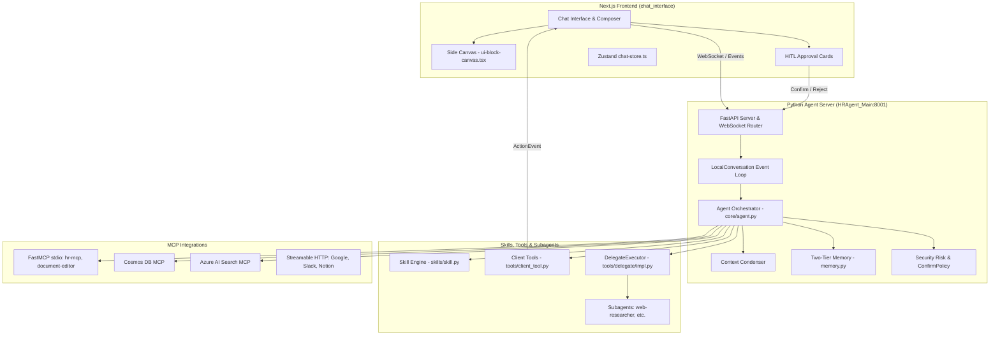
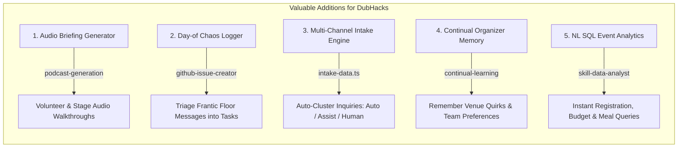

# Event Operations Agent — Codebase Reuse & Adaptation Audit

**Repository Under Review:** `ClosedAI` (`ClosedAI-main/HRAgent_Main`)  
**Target Project:** DubHacks Event Operations Agent (Outreach, Vendors, Logistics)  
**Audit Date:** October 17, 2026  
**Auditor:** Antigravity AI  

---

## Executive Summary

The `ClosedAI` repository is a comprehensive, production-grade agentic system derived from **OpenHands** and tailored as an enterprise AI Copilot. It combines a robust Python FastAPI backend (`HRAgent_Main`), an extensive Model Context Protocol (MCP) tool integration layer, an AgentSkills-compatible skill engine, a full React/Next.js generative UI side canvas (`chat_interface`), and a deterministic offline test harness.

For a 4-person team tackling DubHacks in 24 hours, **this repository is a goldmine**:
1. **~70% of necessary infrastructure already exists and is executable**, including human-in-the-loop (HITL) approval gates, multi-channel triage workflows, persistent memory, subagent delegation, AcroForm/flat-PDF document manipulation, and a dark-mode generative UI canvas with 58 pre-built components.
2. **Several HR workflows map directly to event operations** once business rules are adapted: employee onboarding translates into vendor/sponsor onboarding; interview loops translate into speaker/sponsor scheduling; and PTO coverage handoffs translate into volunteer/staff run-of-show logistics.
3. **Valuable unrequested capabilities** (e.g., real-time audio podcast/briefing generation, incident logging from chaotic voice/text inputs, and natural-language SQL event analytics) can elevate the project from a standard hackathon submission into a standout, production-ready system.

---

## 1. Architectural Overview & Skill Subsystem



### 1.1 Orchestration & Runtime Execution
- **Core Loop:** The runtime is powered by `LocalConversation` (`HRAgent_Main/core/conversation/impl/local_conversation.py`), which manages a deterministic finite state machine (`ConversationState`). Execution proceeds in turns via asynchronous event streams (`ActionEvent` and `ObservationEvent`).
- **LLM Routing:** Model abstraction is managed by `LLM` (`HRAgent_Main/models/llm/llm.py`) backed by `litellm`. It supports drop-in provider switching (OpenAI, Azure Foundry, Groq, Anthropic, Gemini, local Ollama) without code modifications.
- **Context Management:** Token budget overflow is guarded by `PipelineCondenser` and `LLMSummarizingCondenser` (`HRAgent_Main/context/condenser/`), which summarize older trajectory turns while preserving tool call integrity.

### 1.2 Skill Definition, Discovery & Progressive Disclosure
The repository implements the modern **AgentSkills standard** (`https://agentskills.io/specification`) with backward compatibility for legacy Markdown formats:
- **Formats:**
  1. *AgentSkills Standard:* Skill directories containing a `SKILL.md` file with YAML frontmatter (`name`, `description`, `compatibility`, `allowed_tools`) and resource subdirectories (`scripts/`, `references/`, `assets/`).
  2. *Legacy Markdown:* Standalone `.md` files parsed via `frontmatter`.
- **Discovery Hierarchy:** Evaluated in priority order:
  1. *User Tier:* `~/.agents/skills/`, `~/.HRAgent/skills/`
  2. *Project Tier:* `<workspace>/.agents/skills/`, `<workspace>/.HRAgent/skills/`
  3. *Public/Marketplace Tier:* Cloned from Git (`PUBLIC_SKILLS_REPO`) into a local cache directory.
- **Trigger Mechanisms:**
  - `KeywordTrigger` (`skills/trigger.py`): Matches token-bounded keywords (e.g., regex `(?<![a-z0-9])keyword(?![a-z0-9])`). When triggered, skill instructions are auto-injected into the prompt.
  - `PathTrigger`: Evaluates Git-style glob patterns against touched files.
  - `TaskTrigger`: Fires based on task classifications.
  - `Always-On` (no trigger): Inlines content directly into `<REPO_CONTEXT>`.
- **Progressive Disclosure:** Skills without auto-inject triggers are advertised compactly in `<available_skills>` (displaying only `name`, `description`, and file path). The agent retrieves full instructions dynamically using the built-in `InvokeSkillAction` (`tools/builtins/invoke_skill.py`) or reads references on demand, preventing prompt bloat.

### 1.3 Subagent Delegation
- `DelegateExecutor` (`tools/delegate/impl.py`) enables the orchestrating agent to spawn dedicated child agents (`LocalConversation` instances) with scoped tools, isolated contexts, and specific system prompts (e.g., `web-researcher`). It supports blocking execution and handles confirmation bubbling from child to parent.

### 1.4 Human-In-The-Loop (HITL) Controls & Safety
- **Client Tools Bridge:** `tools/client_tool.py` allows external clients to register tools via JSON schemas (`ClientToolSpec`). When an action tool (e.g., `send_email`) is called, the backend halts execution, emits an `ActionEvent` over the WebSocket, and waits for explicit user confirmation (`/api/conversations/{id}/events/respond_to_confirmation`).
- **Security Policy:** `security/policies/confirmation_policy.py` (`ConfirmRisky`) enforces mandatory approvals for actions marked `SecurityRisk.HIGH`.

### 1.5 Side Canvas & Generative UI
- The Next.js frontend (`chat_interface/components/ui-block-canvas.tsx`) features an established generative UI engine (`agent-ui-blocks`). It parses fenced code blocks tagged ```` ```ui-block ```` emitting `{ "type": string, "version": 1, "props": object }` and renders them into **58 pre-built dark-mode React components** (charts, timelines, steppers, checklists, spend breakdowns, comparison tables, avatar groups, and approval cards).

### 1.6 Persistence & Memory
- **Two-Tier Memory:** `HRAgent_Main/memory/memory.py` reads user-level (`~/.HRAgent/memory/MEMORY.md`) and project-level (`<workspace>/.HRAgent/memory/MEMORY.md`) markdown indexes, packing up to 6,000 characters into the prompt with automatic top-line truncation.
- **Cosmos DB & Document Storage:** Backed by an Azure Cosmos DB MCP integration and Azure Blob Storage for metadata and binary file persistence.

---

## 2. Comprehensive Inventory of All Skills & Components Reviewed

The repository contains **50 distinct skills, tools, subagents, and modular workflows** across 7 locations. Every item has been inspected and assigned a relevance verdict for the DubHacks Event Operations Agent:

| # | Name / Component | Source Location | Category / Format | Core Capability | Relevance Verdict |
|---|---|---|---|---|---|
| **1** | `agent-ui-blocks` | `agent-ui-blocks-extracted/agent-ui-blocks/SKILL.md` | Generative UI (AgentSkills) | 58 structured React UI blocks (timelines, steppers, spend, comparisons) | **Directly Reusable** |
| **2** | `document-editor` | `HRAgent_Main/marketplaces/integrations/document-editor` | MCP Integration (Rust stdio) | AcroForm PDF form filling, flat-PDF text overlay, DOCX validation | **Directly Reusable** |
| **3** | `web-researcher` | `HRAgent_Main/tools/preset/subagents/web_researcher.md` | Subagent Definition | Web research via Tavily API, Fetch, and browser navigation | **Directly Reusable** |
| **4** | `client_tool.py` + `hr-actions.ts` | `tools/client_tool.py` & `chat_interface/lib/hr-actions.ts` | Infrastructure (Python + TS) | HITL action interception, confirmation modal, draft review | **Directly Reusable** |
| **5** | `memory.py` | `HRAgent_Main/memory/memory.py` | Infrastructure (Python) | Two-tier persistent Markdown memory loader with character budgeting | **Directly Reusable** |
| **6** | `mock_llm.py` + `e2e_driver.py` | `HRAgent_Main/tests/mock_llm.py` | Test Harness (FastAPI) | Deterministic offline LLM mock with marker controls (`[[TOOL:...]]`) | **Directly Reusable** |
| **7** | `DelegateExecutor` | `HRAgent_Main/tools/delegate/impl.py` | Infrastructure (Python) | Multi-agent delegation, parent-child conversation spawning | **Directly Reusable** |
| **8** | `planning.py` | `HRAgent_Main/tools/preset/planning.py` | Agent Preset (Python) | Structured 5-stage execution plan (Objective, Context, Steps, Testing) | **Directly Reusable** |
| **9** | `api-integration-specialist` | `.agents/skills/api-integration-specialist/SKILL.md` | AgentSkills Standard | Guidance for OAuth 2.0, REST, webhooks, rate limits, retry logic | **Directly Reusable** |
| **10** | `mcp-builder` | `.agents/skills/mcp-builder/SKILL.md` | AgentSkills Standard | Guide for creating FastMCP and TypeScript MCP servers | **Directly Reusable** |
| **11** | `podcast-generation` | `.agents/skills/podcast-generation/SKILL.md` | AgentSkills Standard | Azure OpenAI Realtime Mini audio synthesis via WebSocket | **Valuable Addition** |
| **12** | `github-issue-creator` | `.agents/skills/github-issue-creator/SKILL.md` | AgentSkills Standard | Transforms chaotic voice notes, photos, and messages into structured issues | **Valuable Addition** |
| **13** | `intake-data.ts` (Triage Engine) | `chat_interface/lib/intake-data.ts` | Workflow Engine (TypeScript) | Multi-channel triage, pattern clustering, disposition (`auto`/`assist`/`human`) | **Valuable Addition** |
| **14** | `continual-learning` | `.agents/skills/continual-learning/SKILL.md` | AgentSkills Standard | Feedback loops, error reflection, convention and preference persistence | **Valuable Addition** |
| **15** | `skill-data-analyst` | `chat_interface/.../skill-data.ts` | Mock / Catalog Skill | Translates natural language into read-only SQL queries and result tables | **Valuable Addition** |
| **16** | `skill-meeting-summary` | `chat_interface/.../skill-data.ts` | Mock / Catalog Skill | Extracts decisions, action items, owners, and deadlines from transcripts | **Adaptable** |
| **17** | `skill-incident` | `chat_interface/.../skill-data.ts` | Mock / Catalog Skill | Incident triage, timeline creation, severity escalation | **Adaptable** |
| **18** | `hr-onboarding` | `docs/project_audit.md` 2e (`~/.HRAgent/skills`) | Live Skill (Markdown) | Packet assembly, checklist lookup, fillable PDF coordination | **Adaptable** |
| **19** | `hr_mcp` (`server.py`) | `ClosedAI-main/hr_mcp/server.py` | FastMCP Server (Python) | Seeded employee lookup, org chart, PTO balance, policy RAG | **Adaptable** |
| **20** | `hr-data.ts` (WorkItem Engine) | `chat_interface/lib/hr-data.ts` | Workflow Engine (TypeScript) | Step-by-step state tracker (`RunStep`), SLA timers, external references | **Adaptable** |
| **21** | `cosmos-db` | `marketplaces/integrations/cosmos-db` | MCP Integration (Python stdio) | Query, count, schema discovery for Azure Cosmos DB document containers | **Adaptable** |
| **22** | `azure-ai-search` | `marketplaces/integrations/azure-ai-search` | MCP Integration (Node stdio) | Hybrid, vector, and semantic search over indexed policy/event documents | **Adaptable** |
| **23** | `postgres` | `marketplaces/integrations/postgres` | MCP Integration (Node stdio) | Read-only SQL queries and schema inspection | **Adaptable** |
| **24** | `google-calendar` | `marketplaces/integrations/google-calendar` | MCP Integration (HTTP Stream) | Event creation, schedule search, availability lookup | **Adaptable** |
| **25** | `gmail` | `marketplaces/integrations/gmail` | MCP Integration (HTTP Stream) | Draft creation, thread search, label management | **Adaptable** |
| **26** | `slack` | `marketplaces/integrations/slack` | MCP Integration (HTTP Stream) | Channel messages, history search, team communication | **Adaptable** |
| **27** | `notion` | `marketplaces/integrations/notion` | MCP Integration (HTTP Stream) | Database, page, and block management for event runbooks | **Adaptable** |
| **28** | `linear` | `marketplaces/integrations/linear` | MCP Integration (HTTP Stream) | Issue creation, status tracking, logistics task management | **Adaptable** |
| **29** | `google-people` | `marketplaces/integrations/google-people` | MCP Integration (HTTP Stream) | Directory and contact search for speakers/sponsors | **Adaptable** |
| **30** | `google-drive` | `marketplaces/integrations/google-drive` | MCP Integration (HTTP Stream) | File search, upload, permissions for sponsor assets and permits | **Adaptable** |
| **31** | `microsoft-365` | `marketplaces/integrations/microsoft-365` | MCP Integration (Node stdio) | Outlook email, calendar, contacts, OneDrive file search | **Adaptable** |
| **32** | `jira` | `marketplaces/integrations/jira` | MCP Integration (HTTP Stream) | Atlassian teamwork graph objects and context | **Adaptable** |
| **33** | `github` | `marketplaces/integrations/github` | MCP Integration (Node stdio) | Repos, issues, PRs for hackathon project submissions | **Adaptable** |
| **34** | `google-chat` | `marketplaces/integrations/google-chat` | MCP Integration (HTTP Stream) | Spaces and chat messages | **Adaptable** |
| **35** | `invoke_skill.py` | `HRAgent_Main/tools/builtins/invoke_skill.py` | Built-in Tool (Python) | Dynamic on-demand loading of AgentSkills by name | **Directly Reusable** |
| **36** | `vision_inspect.py` | `HRAgent_Main/tools/builtins/vision_inspect.py` | Built-in Tool (Python) | Multimodal visual inspection of UI/documents | **Directly Reusable** |
| **37** | `codebase-analysis` | `.agents/skills/codebase-analysis/SKILL.md` | AgentSkills Standard | Code comprehension and repository mapping | Out of Scope |
| **38** | `frontend-design-review` | `.agents/skills/frontend-design-review/SKILL.md` | AgentSkills Standard | UI/UX accessibility and responsive design audit | Out of Scope |
| **39** | `security-engineering` | `.agents/skills/security-engineering/SKILL.md` | AgentSkills Standard | Cloud security architecture, threat modeling | Out of Scope |
| **40** | `skill-creator` | `.agents/skills/skill-creator/SKILL.md` | AgentSkills Standard | Authoring AgentSkills-compliant skills | Out of Scope |
| **41** | `testing-strategy` | `.agents/skills/testing-strategy/SKILL.md` | AgentSkills Standard | Test pyramid design and QA automation planning | Out of Scope |
| **42** | `applicationinsights-web-ts` | `.agents/skills/applicationinsights-web-ts/SKILL.md` | AgentSkills Standard | Azure App Insights telemetry integration | Out of Scope |
| **43** | `cloud-solution-architect` | `.agents/skills/cloud-solution-architect/SKILL.md` | AgentSkills Standard | Enterprise cloud infrastructure design | Out of Scope |
| **44** | `copilot-sdk` | `.agents/skills/copilot-sdk/SKILL.md` | AgentSkills Standard | Microsoft Copilot Studio integration | Out of Scope |
| **45** | `debugview` | `.agents/skills/debugview/SKILL.md` | AgentSkills Standard | Azure App Insights DebugView tracing | Out of Scope |
| **46** | `entra-agent-id` | `.agents/skills/entra-agent-id/SKILL.md` | AgentSkills Standard | Microsoft Entra ID agent authentication | Out of Scope |
| **47** | `kql` | `.agents/skills/kql/SKILL.md` | AgentSkills Standard | Kusto Query Language for Log Analytics | Out of Scope |
| **48** | `microsoft-docs` | `.agents/skills/microsoft-docs/SKILL.md` | AgentSkills Standard | Azure/Microsoft Learn documentation lookup | Out of Scope |
| **49** | `architecture-patterns` | `.agents/skills/architecture-patterns/SKILL.md` | AgentSkills Standard | Enterprise architectural patterns catalog | Out of Scope |
| **50** | `skill-pr-review` | `chat_interface/.../skill-data.ts` | Mock / Catalog Skill | Pull request code review and diff analysis | Out of Scope |

---

## 3. Ranked Candidate Components for Event Operations

Below is the ranked matrix of components with the highest ROI for your Event Operations Agent, detailing exact source paths, behavioral differences, implementation evidence, and adaptation effort.

| Rank | Component & Source Path | Existing Behavior | Event Operations Application | Reuse vs. Adapt | Required Logic Changes | Dependencies | Implementation Evidence | Est. Effort |
|:---:|---|---|---|:---:|---|---|---|:---:|
| **1** | **Side Canvas UI Blocks**<br>`chat_interface/components/ui-block-canvas.tsx`<br>`agent-ui-blocks-extracted/.../SKILL.md` | Generates & renders 58 dark-mode UI blocks (charts, steppers, approvals, checklists, cards) from JSON fences. | **Outreach, Vendors, Logistics:** Instant visual presentation for run-of-show schedules, speaker availability, quote comparison cards, vendor checklists. | **Direct Reuse** | None. Use existing block types (`checklist`, `stepper`, `spend-breakdown`, `before-after-comparison`, `approval`, `employee-card-availability`). | React 19, Recharts, Lucide-React | **Executable Code:** 1,353 lines of verified React components in active frontend. | **0.5 hrs** (Prompt wiring only) |
| **2** | **HITL Client Tools & Approvals**<br>`HRAgent_Main/tools/client_tool.py`<br>`chat_interface/lib/hr-actions.ts`<br>`chat_interface/components/chat-conversation.tsx` | Emits `ActionEvent`, pauses agent execution, renders approval card in chat, resumes upon user accept/reject. | **Outreach & Vendors:** Prevents unsanctioned emails to sponsors/speakers; requires organizer sign-off before purchasing/submitting vendor forms. | **Direct Reuse** | Rename action kinds (`sponsor_email`, `vendor_quote_approval`). Extend parameters to accept quote attachments. | FastAPI backend, Next.js WebSocket route | **Executable Code:** Verified working end-to-end via `/api/chat/confirm`. | **1.0 hr** |
| **3** | **Document Editor MCP**<br>`HRAgent_Main/marketplaces/integrations/document-editor/`<br>`server/` (`office-oxide-mcp`) | Fills PDF AcroForms, overlays text on flat PDFs, extracts tables, validates PDF structure without converting. | **Vendors & Logistics:** Fills UW venue facility use permits, city fire safety applications, electrical orders, and booth agreements. | **Direct Reuse** | None. Exposes `office_fill_pdf_form`, `office_overlay_pdf_text`, `office_validate`, `office_read`. | Rust binary (`office-oxide-mcp`) | **Executable Code:** Verified on real `i9_form.pdf` (133 AcroForm fields, 6/6 validation). | **1.0 hr** |
| **4** | **Web Researcher Subagent**<br>`HRAgent_Main/tools/preset/subagents/web_researcher.md`<br>`HRAgent_Main/tools/delegate/impl.py` | Delegated child agent using Tavily API, Fetch, and browser automation to return structured research summaries. | **Outreach & Vendors:** Sources potential sponsors, discovers speaker bios/talks, compares supplier rates (swag, catering, AV rentals). | **Direct Reuse** | Update prompt instructions to prioritize conference/hackathon domains and pricing tables. | `tavily-mcp`, `mcp-server-fetch` | **Executable Prompt & Code:** Subagent registry in `tools/delegate/impl.py`. | **1.0 hr** |
| **5** | **Offline Mock LLM Test Harness**<br>`HRAgent_Main/tests/mock_llm.py`<br>`HRAgent_Main/tests/e2e_driver.py` | Local mock LLM server executing deterministic responses, tool-calling markers (`[[TOOL:...]]`), and error simulation. | **Shared Platform:** Enables 4 team members to develop and test complex agent workflows offline without API rate limits or costs. | **Direct Reuse** | Add event-specific tool-calling fixtures (`[[TOOL:compare_quotes:...]]`). | FastAPI, `uv` | **Executable Code:** 22 passing e2e driver tests running locally. | **0.5 hrs** |
| **6** | **Two-Tier Persistent Memory**<br>`HRAgent_Main/memory/memory.py` | Reads user and workspace `MEMORY.md`, manages 6,000 character budget, auto-injects into prompt context. | **Shared Platform:** Retains event constraints across turns (e.g. "UW HUB room 214 max capacity is 120; catering must be nut-free"). | **Direct Reuse** | Point `MEMORY_INDEX_RELPATH` to `.event_ops/memory/MEMORY.md`. | Python `pathlib` | **Executable Code:** Pure Python loader with character budget unit checks. | **0.5 hrs** |
| **7** | **Employee Onboarding → Vendor Onboarding**<br>`docs/project_audit.md` 2e<br>`chat_interface/lib/hr-data.ts` (`auto-onboarding`) | Collects tax info (W-4, I-9), checks requirements, prefills PDFs, requests manager signoff, tracks checklist. | **Vendors:** Onboards suppliers: ingest quote, verify Certificate of Insurance (COI), fill booth application, schedule loading dock. | **Adaptation** | **Logic Difference:** HR is 1-to-1 person-to-company. Vendor onboarding is multi-vendor competitive evaluation with deadline penalties and delivery constraints. | Document Editor MCP, FastMCP | **Partially Executable:** Proven in chat UI with real PDFs; checklist mapping needs schema update. | **2.5 hrs** |
| **8** | **Interview Scheduling → Speaker Availability**<br>`ClosedAI-main/hr_mcp/server.py` (`org_chart`, `pto_balance`)<br>`marketplaces/integrations/google-calendar` | Checks employee calendar availability, resolves manager-report conflicts, books meeting rooms. | **Outreach:** Schedules speaker keynotes, workshops, and rehearsals; resolves room and AV equipment conflicts. | **Adaptation** | **Logic Difference:** HR assumes internal shared Exchange calendars. Event operations involves external speakers across timezones, async delays, and stage dependencies. | Google Calendar MCP / FastMCP | **Hybrid:** `google-calendar` config exists; `hr_mcp` seed data provides offline mock. | **2.0 hrs** |
| **9** | **FastMCP Offline Event Data Server**<br>`ClosedAI-main/hr_mcp/server.py`<br>`ClosedAI-main/hr_mcp/seed_data.py` | FastMCP stdio server exposing employee profiles, PTO balances, org charts, and policy search with canvas hints. | **Shared Platform:** Exposes `speakers_lookup`, `vendor_quotes`, `run_of_show`, `venue_policies` with `_canvas` rendering hints. | **Adaptation** | Replace employee dictionaries in `seed_data.py` with DubHacks mock database (sponsors, speakers, vendors, schedule). | `fastmcp` (installed in `.venv`) | **Executable Code:** Auto-spawned by backend; stdio transport verified. | **2.0 hrs** |
| **10** | **Cosmos DB Event Records Store**<br>`marketplaces/integrations/cosmos-db/` | Queries, counts, lists collections, and inspects JSON documents in Azure Cosmos DB containers. | **Shared Records:** Persists event records across 4 containers: `sponsors`, `speakers`, `vendors`, `logistics_tasks`. | **Adaptation** | Update container names in `plugin.json` from `employees`/`policies` to event schemas. | `fastmcp`, Azure Cosmos SDK | **Executable Code:** 9 tools verified working live against 517 Cosmos documents. | **1.5 hrs** |
| **11** | **Azure AI Search Venue Knowledge Base**<br>`marketplaces/integrations/azure-ai-search/` | Hybrid and vector search over indexed PDF documents (`company-policies`). | **Logistics & Vendors:** Grounded RAG over UW facility guidelines, fire marshal limits, catering policies, and hackathon rules. | **Adaptation** | Re-index with DubHacks documents (UW HUB facility guide, sponsorship prospectus, hackathon handbook). | `@ignitionai/azure-ai-search-mcp` | **Executable Code:** Verified working live against `company-policies` index. | **2.0 hrs** |

---

## 4. Deep-Dive: Logic Transformations (Looking Beyond Terminology)

Adapting HR code into an Event Operations Agent requires fundamental architectural shifts, not mere field renames:

### 4.1 Interview Scheduling vs. Speaker & Sponsor Coordination
- **The HR Model:** Assumes an authoritative internal directory (Active Directory / Microsoft Graph) where all interviewers share a calendar tenant. Finding availability is a synchronous constraint-satisfaction query over local calendar slots.
- **The Event Reality:**
  - **External Heterogeneity:** Speakers and sponsor reps use distinct external calendar providers (Google, Outlook, personal email). You cannot query their free/busy calendar directly.
  - **Asynchronous State Machine:** Outreach requires proposing multi-slot options, awaiting confirmation, handling asynchronous rejections, and setting expiration timeouts.
  - **Resource Stacking:** Booking a speaker is not just a time slot—it requires co-allocating a physical stage, AV equipment (microphones, HDMI switchers), volunteer mic runners, and rehearsal slots. A cancellation triggers cascading dependency invalidations across the entire run-of-show.

### 4.2 Employee Onboarding vs. Vendor & Sponsor Onboarding
- **The HR Model:** A linear, sequential checklist for a single individual (Offer Letter → I-9 Form → Benefits Election → Equipment Provisioning). Every step is deterministic, with standard compliance deadlines.
- **The Event Reality:**
  - **Multi-Party Competitive Bidding:** Vendor onboarding begins with comparative quote analysis (e.g., comparing 3 catering suppliers on price-per-head, delivery fees, dietary coverage, and cancellation clauses).
  - **Non-Negotiable Deadlines & Hard Minimums:** A missing vendor submission (e.g., electrical permit 14 days prior to doors open) blocks the event license.
  - **Multi-Signoff Hierarchy:** Contracts require legal indemnification review, venue approval (Certificate of Insurance naming the University as additional insured), and financial budget check before signing.

### 4.3 PTO Coverage Handoffs vs. Logistics Run-of-Show & Shift Transitions
- **The HR Model:** An employee takes 3 days of PTO; work tasks are reassigned to peers, and an out-of-office message is set.
- **The Event Reality:**
  - **Minute-by-Minute Timeline:** The run-of-show is an interdependent DAG (Directed Acyclic Graph). Opening ceremony delays compress lightning talks and push sponsor booth setup.
  - **On-the-Floor Handoffs:** Volunteer shift transitions require physical handoffs (badge scanners, walkie-talkies, mentor room coverage). If a volunteer no-shows, the agent must instantly detect the coverage gap, alert the volunteer coordinator, and recommend re-allocation based on current room traffic.

---

## 5. Valuable Unrequested Capabilities to Expand Event Functionality

These 5 high-impact capabilities exist in the repository or its design patterns and can expand your Event Operations Agent beyond standard expectations:



### 1. AI Audio Briefings & Run-of-Show Podcast Generator
- **Source:** `.agents/skills/podcast-generation/SKILL.md`
- **Existing Behavior:** Connects to Azure OpenAI's Realtime Mini model over WebSocket, streams text, collects PCM audio chunks, and outputs a WAV audio narrative with a conversational tone.
- **Event Use Case:** Organizing team members on the hackathon floor cannot stare at laptop screens. The agent generates **2-minute real-time audio briefings**:
  - *Morning Volunteer Walkthrough:* "Good morning DubHacks crew! Doors open at 8:00 AM. Sponsor check-in is at HUB South Ballroom. Lunch delivery is confirmed for 12:30 PM..."
  - *Speaker Stage Intros:* Synthesizing polished 30-second speaker introduction voiceovers for AV operators.

### 2. Day-of Chaos / Incident Logger
- **Source:** `.agents/skills/github-issue-creator/SKILL.md` and `chat_interface/.../skill-incident`
- **Existing Behavior:** Ingests fragmented, unformatted text, error logs, or voice transcripts, infers missing context, strips noise, and writes structured Markdown tickets with reproduction steps, severity, and visual attachments.
- **Event Use Case:** During peak hackathon hours (1,000+ attendees), organizers receive chaotic messages: *"WiFi down near table 14"*, *"Out of medium t-shirts at check-in"*, *"The HDMI switcher on Stage 2 is flickering"*. The agent parses the panic, extracts the core incident, assigns a priority level, identifies the affected venue zone, and creates an actionable task for the floor team.

### 3. Multi-Channel Intake Triage & Disposition Engine
- **Source:** `chat_interface/lib/intake-data.ts`
- **Existing Behavior:** Ingests inquiries across 7 channels (`email`, `portal`, `chat`, `system`), clusters them by emerging topic patterns, and assigns a tripartite disposition:
  - `auto`: Fully automated playbook execution without human intervention.
  - `assist`: Agent drafts the response or document, awaiting one-click human approval.
  - `human`: Flags ambiguities requiring organizer judgment.
- **Event Use Case:** Triage inbound hackathon traffic. Sponsor inquiries about booth dimensions are handled automatically (`auto`); bespoke sponsorship requests are drafted for review (`assist`); safety or code-of-conduct inquiries are immediately escalated to lead organizers (`human`).

### 4. Continual Organizer Preference Learning
- **Source:** `.agents/skills/continual-learning/SKILL.md` & `HRAgent_Main/memory/memory.py`
- **Existing Behavior:** Evaluates tool failures, captures explicit user corrections, and stores learnings in a dual-tier database (`local` vs. `global`) to alter future agent behavior.
- **Event Use Case:** The agent learns DubHacks organizer preferences dynamically:
  - *"Always leave 15 minutes between workshops for room reset."*
  - *"Microsoft requires 4 dedicated 20A power drops for their mentor booth."*
  - *"District Market requires catering final counts 72 hours in advance."*  
  These rules persist across sessions and prevent repeated mistakes.

### 5. Natural Language Event Analytics Query Engine
- **Source:** `chat_interface/.../skill-data.ts` (`skill-data-analyst`) & `marketplaces/integrations/postgres`
- **Existing Behavior:** Translates natural language questions into safe, read-only SQL queries, executes them against relational databases, and visualizes result tables in the canvas.
- **Event Use Case:** Organizers need quick operational answers without opening spreadsheets:
  - *"How many attendees requested vegan meals?"*
  - *"What is our committed sponsor funding vs. outstanding invoices?"*
  - *"Which workshops are currently over 80% capacity?"*

---

## 6. Top Five Recommendations for a 4-Person, 24-Hour Hackathon

To maximize demo impact while minimizing development risk, split your 4-person team across these five components:

```
┌────────────────────────────────────────────────────────────────────────┐
│               RECOMMENDED 24-HOUR HACKATHON WORK SPLIT                │
├────────────────────┬───────────────────────────────────────────────────┤
│ Engineer 1 (Lead)  │ Side Canvas Generative UI & Flow Integration      │
│ Engineer 2 (Back)  │ FastMCP Event Data Server & Cosmos Records        │
│ Engineer 3 (Doc/RAG│ Document Editor MCP & Venue Knowledge Base RAG   │
│ Engineer 4 (Agent) │ Web Researcher Subagent & HITL Outreach Tools     │
└────────────────────┴───────────────────────────────────────────────────┘
```

### Recommendation 1: Adopt the Side Canvas & Generative UI Engine
- **Source:** `chat_interface/components/ui-block-canvas.tsx` + `agent-ui-blocks-extracted/`
- **Why It Matters:** Hackathons are won on visual polish and user experience. Building custom UI components from scratch takes hours.
- **What You Get:** 58 responsive, dark-mode React components ready to render instantly via markdown fences:
  - `stepper` for the Run-of-Show.
  - `checklist` for Vendor & Stage Readiness.
  - `spend-breakdown` & `before-after-comparison` for Vendor Quotes.
  - `employee-card-availability` for Speaker & Mentor Schedules.
- **Time Saved:** **8–10 hours of frontend development.**

### Recommendation 2: Reuse the HITL Client Tools & Approval Flow
- **Source:** `HRAgent_Main/tools/client_tool.py` + `chat_interface/lib/hr-actions.ts`
- **Why It Matters:** Hackathon judges are wary of autonomous agents sending unvetted emails or spending money. HITL guarantees safety.
- **What You Get:** The agent prepares complete drafts (sponsor emails, speaker invites, purchase approvals) and renders an **"Approve & Send"** card directly in the chat stream. Execution is paused until the user clicks Approve.
- **Time Saved:** **4–5 hours of full-stack WebSocket confirmation plumbing.**

### Recommendation 3: Integrate the Document Editor MCP for Forms & Permits
- **Source:** `HRAgent_Main/marketplaces/integrations/document-editor/` (`office-oxide-mcp`)
- **Why It Matters:** Manual form filling is one of the biggest administrative headaches in event management.
- **What You Get:** Native AcroForm field filling and flat-PDF text overlays that preserve original styling without corrupting layout. You can stage real UW facility permit PDFs and have the agent populate event dates, expected headcount, and sponsor names automatically.
- **Time Saved:** **6–8 hours of complex PDF parsing/generation coding.**

### Recommendation 4: Deploy the Web Researcher Subagent
- **Source:** `HRAgent_Main/tools/preset/subagents/web_researcher.md` + `tools/delegate/impl.py`
- **Why It Matters:** Manually finding sponsor contacts and speaker bios during a live demo is slow and brittle.
- **What You Get:** A self-contained research subagent that uses Tavily API and Fetch to search the live web, cross-reference sources, extract emails, and return formatted candidate summaries with URLs.
- **Time Saved:** **4–5 hours of web scraping and subagent prompt engineering.**

### Recommendation 5: Use the Offline Mock LLM Test Harness for Fast Iteration
- **Source:** `HRAgent_Main/tests/mock_llm.py` + `tests/e2e_driver.py`
- **Why It Matters:** Hackathon WiFi is notoriously unstable, and LLM rate limits can halt progress.
- **What You Get:** A lightweight, deterministic local FastAPI mock server that simulates tool calling via markers (`[[TOOL:vendor_lookup:...]]`). All 4 engineers can write and verify agent skills locally without internet access or API token costs.
- **Time Saved:** **3–4 hours of debugging network timeouts and API errors.**

---

## 7. Important Gaps, Blockers & Known Issues

Before building, be aware of the following architectural quirks discovered during our audit:

1. **Remote OAuth Marketplace Stubs:**
   - *Issue:* Integrations like `gmail`, `google-calendar`, and `slack` in `marketplaces/integrations/` define `.mcp.json` pointing to cloud endpoints with OAuth2 (`https://gmailmcp.googleapis.com/mcp/v1`).
   - *Impact:* They require registered Google/Slack developer apps with redirect URLs. For a 24-hour hackathon, **do not attempt full OAuth setup**. Instead, either use local API keys via standard Python libraries or write a simple FastMCP wrapper like `hr_mcp/server.py`.
2. **React 19 Infinite Re-render Bug (Documented in `docs/bug_fixes.md` #10a):**
   - *Issue:* Switching conversations or receiving specific Side Canvas updates intermittently triggers `Maximum update depth exceeded` in React.
   - *Impact:* The application self-recovers, but avoid excessive re-mounting of `SideCanvas` during demo presentations.
3. **Canvas State Persistence on New Chat (`docs/bug_fixes.md` #10b):**
   - *Issue:* Clicking "New Chat" in the frontend does not automatically clear the Side Canvas or Activity panel from the previous conversation.
   - *Impact:* Stale data may be visible until a new tool call fires.
4. **Local Host Path vs. Container Sandbox Assumption (`docs/project_audit.md` 2d):**
   - *Issue:* Because OpenHands was originally designed to run inside Docker containers, the agent sometimes assumes `/workspace/...` Linux paths instead of Windows host paths.
   - *Impact:* Explicitly instruct the agent in system prompts to use relative workspace paths or host-compatible file resolution.
5. **Multi-Turn Premature Turn Completion (`docs/project_audit.md` 2d):**
   - *Issue:* When executing long chains of tool calls (5+ calls), the agent occasionally stops on an intermediate thought ("I will now check...") without rendering its final synthesis.
   - *Impact:* Add a system prompt guard: *"Always conclude your turn with a complete summary and emit the required ui-block payload before stopping."*
6. **Public Skills Repo 404 (`docs/bug_fixes.md` #3):**
   - *Issue:* `PUBLIC_SKILLS_REPO` defaults to `https://github.com/HRAgents/extensions`, which returns HTTP 404.
   - *Impact:* Public skills sync logs a non-fatal warning. Store all hackathon event skills in `.agents/skills/` (project-level), which loads deterministically and offline.

---

## Conclusion & Next Steps

The `ClosedAI` codebase provides an extraordinary foundation for the DubHacks Event Operations Agent. Rather than starting from an empty repository, your team can begin with an enterprise-grade agent orchestrator, pre-built generative UI blocks, verified PDF editing, and human-in-the-loop safety controls already in place.

By adopting the **Top 5 Recommendations**, your team can bypass weeks of boilerplate infrastructure work and focus 100% of your hackathon hours on event-specific workflows, live integrations, and an unforgettable demo.
